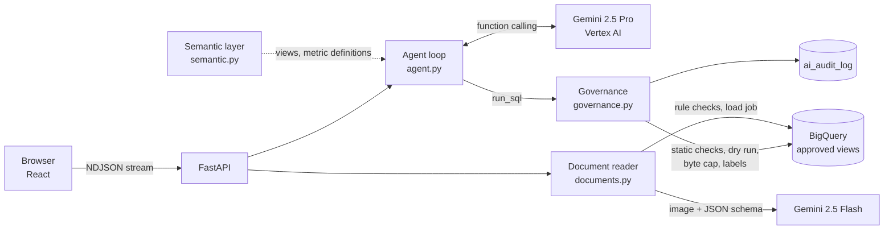

# Freight AI Analytics Platform

Ask freight operations data questions in plain English and read shipping documents with AI, on Google Cloud:
**Gemini on Vertex AI** and **BigQuery**, with governance in code.

Built for an LTL (less-than-truckload) carrier: shipments move from a shipper, through the origin terminal and
sometimes a breakbulk hub, to the destination terminal and the consignee (receiver). All company names and data
are fictional.

| Capability | Who uses it | AI pattern |
|---|---|---|
| **Ask your data**: "Why is Atlanta on-time performance low?" → governed BigQuery SQL → answer, chart, follow-ups | Operations managers, sales, customer service | **Agentic AI**: Gemini plans, runs several queries, reads results and drills down until it can explain |
| **Bills of lading**: a scanned or photographed BOL → structured fields → rule checks → BigQuery | Billing and dock staff | **Gen AI**: one Gemini call with a strict JSON schema, then deterministic validation |
| **Governance**: allowed views, byte caps, audit log | Data owners, security | Plain code: the model never touches BigQuery directly |

## Architecture



**How a question is answered**

1. The system prompt carries the semantic layer: approved views, column meanings and one definition per metric
   (`on_time_rate = AVG(IF(on_time,1,0))` over delivered shipments). This is the same role LookML plays in Looker.
2. Gemini has two tools: `run_sql(sql, purpose)` and `present_answer(answer, chart, follow_ups)`. The loop runs up to
   8 steps. Each step streams to the UI so the user sees what the AI is checking.
3. Every `run_sql` goes through `governance.run_query`. A blocked query or a SQL error goes back to Gemini as the
   tool result, so it corrects itself (for example, a non-BigQuery function or a raw table name).
4. `present_answer` picks which result to chart. The server checks that the chart columns exist.
5. The last 8 turns are kept per session, so "why?" or "break it down by lane" work as follow-ups.

**Why the document reader is not an agent:** one input, one output, a fixed schema. A single call is cheaper,
faster and easier to test. Rules that must be exact (valid NMFC freight class, line weights add up to the total,
hazmat needs an emergency contact, shipper signature) are checked in code, not by the model. Anything doubtful is
marked `NEEDS_REVIEW` for a person.

## Governance

The model writes SQL; code decides whether it runs.

| Control | Where |
|---|---|
| One read-only `SELECT`/`WITH` statement; DML, DDL and scripting keywords refused | `check_sql` |
| Tables only from the approved `v_` views in this project and dataset; raw tables, other datasets and `INFORMATION_SCHEMA` refused (FROM/JOIN lists, comma joins and subqueries are all walked) | `_table_refs`, `check_sql` |
| Dry run first; refused above 200 MB, and the same cap set as `maximum_bytes_billed` | `run_query` |
| At most 500 rows returned to the model | `run_query` |
| Every attempt (allowed, blocked, error) written to `ai_audit_log` and labeled on the BigQuery job | `audit` |
| PII: consignee contact name, phone and email are in no view; residential consignees appear as "Residential customer" | views in `generate.py` |

Note: a BigQuery dry run lists the *base* tables behind a view in `referenced_tables`, so the allowlist cannot rely
on it and parses the SQL instead.

**In production** the same rules would also be enforced by Google Cloud itself, so the code checks are defence in depth:
- a service account that can read only an authorized-views dataset;
- column-level security with policy tags on PII;
- row-level access policies per region or customer;
- VPC Service Controls around BigQuery and Vertex AI;
- CMEK if required;
- audit logs exported to Cloud Logging.

## Data

`python -m app.data.generate` creates the `freight_analytics` dataset with 120 days of synthetic data:
- 14 terminals (3 breakbulk hubs), 20 shippers, 124 consignees;
- about 16,000 shipments, 110,000 tracking events and 230 claims.

It contains patterns worth finding:

- **Atlanta (ATL)** on-time drops to about 79% in the last month. The main cause is missed delivery appointments at one
  grocery DC, plus a linehaul delay from Charlotte, Richmond and Harrisburg 3–5 weeks ago.
- **Memphis hub** has a damage claim rate about 4x the network. Freight class 150 and above is about 2x.
- A Northeast weather event about 8 weeks ago.

## Run locally

Prerequisites: Docker, the gcloud CLI, and a Google Cloud project with the Vertex AI and BigQuery APIs enabled.

```bash
gcloud auth application-default login
```

```bash
cp .env.example .env
```

Set `GOOGLE_CLOUD_PROJECT` in `.env`, then:

```bash
./scripts/dev.sh setup-data
```

```bash
./scripts/dev.sh start
```

Open http://localhost:8060. The API docs are at http://localhost:8061/docs.

Your Application Default Credentials are mounted into the backend read-only, so no keys are stored in the project.

| Command | |
|---|---|
| `./scripts/dev.sh start` / `stop` / `status` / `logs [service]` | Stack lifecycle |
| `./scripts/dev.sh setup-data` | Create the dataset, tables and views, and load the synthetic data |
| `./scripts/dev.sh samples` | Redraw the three sample bills of lading |
| `./scripts/dev.sh test` | Governance unit tests |

## Demo script (about 8 minutes)

1. **Landing page.** The KPI strip comes from fixed SQL, not AI. Say: "Dashboards show *what*; people still ask *why*."
2. **Ask:** "Which 5 destination terminals had the worst on-time delivery in the last 30 days?" Atlanta stands out.
   Open "how the AI got this" and show the SQL and the bytes scanned.
3. **Follow up:** "Why is Atlanta on-time performance low?" Watch it drill down by delay reason, then consignee type.
   It finds missed appointments at grocery DCs. This is the agentic part: it decided which queries to run.
4. **Ask:** "Which hub has the highest damage claim rate, and what does it cost us?" It finds Memphis.
5. **Bills of lading.** Load "Phone photo with errors". Gemini reads a skewed, handwritten BOL. Code flags the missing
   freight class, weights that don't add up and the missing signature. Then load "Hazardous materials": all checks pass.
6. **Governance.** Show the guardrails, the audit log, and a blocked or self-corrected query.
   Try "show me consignee phone numbers": Gemini declines. Even if a prompt talked it into trying, no approved
   view has those columns and the raw `consignees` table is blocked, so the protection does not depend on the model.
7. **Data catalog.** One definition per metric. This is where Looker fits.

## Where Looker fits

This app uses a small semantic layer in Python so it runs anywhere. In a Looker shop the better design is to point
the agent at the LookML model instead of raw views. Metric definitions then live in one governed place, and Looker
row-level permissions apply to AI answers too. Looker's own Gemini features (Conversational Analytics) cover
dashboard users. This app covers custom workflows such as documents and multi-step "why" analysis, and embedding in
operations tools.

## Cost

| Item | Rough cost |
|---|---|
| One question (Gemini 2.5 Pro, 2–5 calls, about 20–40k input tokens) | about $0.03–0.08 |
| One document (Gemini 2.5 Flash, one image) | under $0.01 |
| BigQuery per question (0.5–3 MB scanned) | effectively free (first 1 TB a month is free) |
| Storage (about 30 MB) | cents a month |

Cost controls: the byte cap per query, a step limit per question, Flash for documents, and aggregated queries.

## Production path on Google Cloud

- **Hosting:** Cloud Run for the backend and web, each with its own service account; Identity-Aware Proxy for staff SSO.
- **Sessions:** move them from memory to Firestore or Memorystore.
- **Evaluation:** a Vertex AI evaluation set of real questions with expected SQL results, run on every prompt or model change.
- **Exception explanation (next):** embed shipment event notes and claims text with Vertex AI embeddings, and use
  BigQuery `VECTOR_SEARCH` so the agent can cite similar past incidents.
- **Higher document volume:** Document AI for classification and splitting of multi-page scans, with Gemini for the
  freight-specific fields.

## Project layout

```
backend/app/
  main.py          FastAPI endpoints
  agent.py         Gemini function-calling loop (run_sql, present_answer), streamed as NDJSON
  governance.py    SQL checks, dry run, byte cap, audit log
  semantic.py      Views, metric definitions, glossary given to the model
  documents.py     Bill of lading extraction (JSON schema) and validation
  config.py        Settings from environment
  data/generate.py       Synthetic data and views
  data/make_samples.py   Sample BOL images
backend/tests/     Governance tests
web/src/           React UI: Ask, Bills of lading, Governance, Data catalog
```
