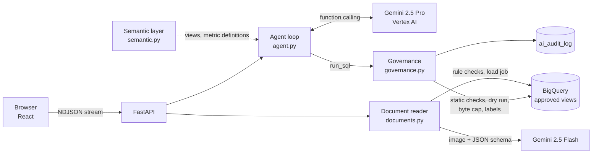

# Freight AI Analytics Platform

Ask freight operations data questions in plain English and read shipping documents with AI, on Google Cloud:
**Gemini on Vertex AI** and **BigQuery**, with governance in code.

Built for an LTL (less-than-truckload) carrier: shipments move from a shipper, through the origin terminal and
sometimes a breakbulk hub, to the destination terminal and the consignee (receiver). All company names and data
are fictional.

| Capability | Who uses it | AI pattern |
|---|---|---|
| **Ask your data**: "Why is Atlanta on-time performance low?" → governed BigQuery SQL → answer, chart, follow-ups | Operations managers, sales, customer service | **Agentic AI**: Gemini plans, runs several queries, reads results and drills down until it can explain |
| **Trailer tracking**: map of every trailer from telematics (GPS, door, cargo and temperature sensors), alerts for detention, unplanned door openings, temperature excursions and idle empties | Dispatch, linehaul planning, claims/security | Fixed SQL with BigQuery GIS for the map and alerts; the same agent answers trailer questions |
| **Bills of lading**: a scanned or photographed BOL → structured fields → rule checks → BigQuery | Billing and dock staff | **Gen AI**: one Gemini call with a strict JSON schema, then deterministic validation |
| **Governance**: allowed views, byte caps, audit log | Data owners, security | Plain code: the model never touches BigQuery directly |

## Architecture



## How it works
1. Ask your data (agentic AI)

The user’s question goes to agent.py together with a system prompt that includes the semantic layer: which views exist, what each column means, and the one agreed formula for each metric.
Gemini 2.5 Pro has two tools, run_sql and present_answer. It calls run_sql with a query and a one-line purpose.
The SQL goes through governance.py:
static checks: a single SELECT, approved views only, no raw tables or metadata;
a BigQuery dry run to estimate size, refusing anything over 200 MB;
execution with a hard byte cap;
the result and the outcome (allowed, blocked or error) written to ai_audit_log.
The rows go back to Gemini, which decides what to do next. It may drill down with another query, or fix its SQL if it was blocked or failed. That loop is what makes it agentic.
Gemini calls present_answer with the explanation, which result to chart, and follow-up questions.
Each step streams to the browser as it happens, so the user sees the reasoning, the SQL and the data scanned.
Session memory keeps recent turns, so follow-ups like “why?” or “break it down by lane” work.

2. Bills of lading (generative AI, not an agent)

An image is uploaded.
Gemini 2.5 Flash makes one call with a strict JSON schema (shipper, consignee, line items, class, weights, hazmat, signature).
Deterministic Python rules validate it: valid NMFC class, line weights match the total, hazmat has an emergency contact, signature present.
The result is saved as READY or NEEDS_REVIEW for a person to approve.

It’s a single call because the task is well-defined. That’s cheaper, faster and easier to test than an agent.

3. Trailer tracking

Data: telematics pings land in trailer_pings, partitioned by day, clustered by trailer, with a GEOGRAPHY point.
Geofencing: ST_DWITHIN in a BigQuery view matches each ping to a terminal or customer site. From that, SQL works out status (moving, at terminal, at customer) and dwell time.
Map and alerts: come from fixed, parameterized SQL, not AI.
AI questions: trailer views are on the same allowlist, so the agent can answer questions like “Was the door opened on the load that had a shortage claim?” by joining trips → loads → shipments → claims.

4. Governance and security

Layer	Control
Data	AI sees only curated views. Customer contact details aren’t in any view, and residential names are masked.
Query	Read-only; one SELECT; allowlisted views; dry-run size check; byte cap; at most 500 rows to the model
Audit	Every AI query is logged with its question, SQL, status, bytes and rows, and shown on the Governance page
Accuracy	The semantic layer forces one definition per metric, and the server checks chart columns exist
Credentials	Application Default Credentials mounted read-only; no API keys in the code

5. Where Looker fits

Now: semantic.py is a stand-in for LookML.
At Estes: the agent would use their Looker model instead, so AI answers match their dashboards and follow Looker permissions.

**How a question is answered**

1. The system prompt carries the semantic layer: approved views, column meanings and one definition per metric
   (`on_time_rate = AVG(IF(on_time,1,0))` over delivered shipments). This is the same role LookML plays in Looker.
2. Gemini has two tools: `run_sql(sql, purpose)` and `present_answer(answer, chart, follow_ups)`. The loop runs up to
   8 steps. Each step streams to the UI so the user sees what the AI is checking.
3. Every `run_sql` goes through `governance.run_query`. A blocked query or a SQL error goes back to Gemini as the
   tool result, so it corrects itself (for example, a non-BigQuery function or a raw table name).
4. `present_answer` picks which result to chart. The server checks that the chart columns exist.
5. The last 8 turns are kept per session, so "why?" or "break it down by lane" work as follow-ups.

**Why the document reader is not an agent:** one input, one output, a fixed schema. A single call is cheaper,
faster and easier to test. Rules that must be exact (valid NMFC freight class, line weights add up to the total,
hazmat needs an emergency contact, shipper signature) are checked in code, not by the model. Anything doubtful is
marked `NEEDS_REVIEW` for a person.

## Trailer tracking

**Storage choice: BigQuery** (with Pub/Sub in front of it in production).
- **Scale:** a large LTL fleet sends millions of pings a day, which BigQuery handles easily:
  - `trailer_pings` is partitioned by day and clustered by trailer, so one trailer's history reads only its blocks;
  - each ping has a `GEOGRAPHY` point.
- **Geofencing in SQL:** `ST_DWITHIN` matches each ping to a terminal or customer site (`v_trailer_pings`), so status
  (moving, at terminal, at customer, stopped en route) and dwell time come from SQL.
- **Same agent, same governance:** the agent can query trailers through the same approved-view model.
- **Joins to freight data:** trailers link to trips, trips to shipments (`v_trailer_loads`), and shipments to claims,
  so "was the door opened on the load that had a shortage claim?" is a single query.
- **Bigtable:** worth adding only for millisecond "where is trailer X now" reads at very high write volume.

```
Telematics units → Pub/Sub → BigQuery subscription → trailer_pings (partitioned by day, clustered by trailer_id)
                          └→ Dataflow (optional) → real-time geofence alerts, Bigtable latest-position cache
```

**Synthetic data:** `python -m app.data.trailers` (or `./scripts/dev.sh setup-trailers`) builds about 240 trailers with
30 days of pings up to the current time.
- **Pings:** every 15 minutes moving, hourly parked, plus door, cargo and motion events.
- **Movement follows the shipments:** freight is grouped into nightly linehaul trips through the hubs, and empties are
  repositioned when a terminal runs short.
- **Patterns:**
  - Detention: trailers dropped at FreshMart DC – Atlanta and Precision Stamping Works – Detroit sit 2–6 days.
  - Empty trailers pile up at the Memphis hub.
  - On loads that later had a shortage claim, the trailer door was opened at an unplanned stop between terminals.
  - One refrigerated trailer rose to about 50 °F on a Charlotte → Atlanta grocery run.

Positions are relative to the time you generate the data, so run `./scripts/dev.sh setup-trailers` on demo day.

## Governance

The model writes SQL; code decides whether it runs.

| Control | Where |
|---|---|
| One read-only `SELECT`/`WITH` statement; DML, DDL and scripting keywords refused | `check_sql` |
| Tables only from the approved `v_` views (11, including six trailer views) in this project and dataset; raw tables, other datasets and `INFORMATION_SCHEMA` refused (FROM/JOIN lists, comma joins and subqueries are all walked) | `_table_refs`, `check_sql` |
| Dry run first; refused above 200 MB, and the same cap set as `maximum_bytes_billed` | `run_query` |
| At most 500 rows returned to the model | `run_query` |
| Every attempt (allowed, blocked, error) written to `ai_audit_log` and labeled on the BigQuery job | `audit` |
| PII: consignee contact name, phone and email are in no view; residential consignees appear as "Residential customer" | views in `generate.py` |

Note: a BigQuery dry run lists the *base* tables behind a view in `referenced_tables`, so the allowlist cannot rely
on it and parses the SQL instead.

**In production** the same rules would also be enforced by Google Cloud itself, so the code checks are defence in depth:
- a service account that can read only an authorized-views dataset;
- column-level security with policy tags on PII;
- row-level access policies per region or customer;
- VPC Service Controls around BigQuery and Vertex AI;
- CMEK if required;
- audit logs exported to Cloud Logging.

## Data

`python -m app.data.generate` creates the `freight_analytics` dataset with 120 days of synthetic data:
- 14 terminals (3 breakbulk hubs), 20 shippers, 124 consignees;
- about 16,000 shipments, 110,000 tracking events and 230 claims.

It contains patterns worth finding:

- **Atlanta (ATL)** on-time drops to about 79% in the last month. The main cause is missed delivery appointments at one
  grocery DC, plus a linehaul delay from Charlotte, Richmond and Harrisburg 3–5 weeks ago.
- **Memphis hub** has a damage claim rate about 4x the network. Freight class 150 and above is about 2x.
- A Northeast weather event about 8 weeks ago.

## Run locally

Prerequisites: Docker, the gcloud CLI, and a Google Cloud project with the Vertex AI and BigQuery APIs enabled.

```bash
gcloud auth application-default login
```

```bash
cp .env.example .env
```

Set `GOOGLE_CLOUD_PROJECT` in `.env`, then:

```bash
./scripts/dev.sh setup-data
```

```bash
./scripts/dev.sh start
```

Open http://localhost:8060. The API docs are at http://localhost:8061/docs.

Your Application Default Credentials are mounted into the backend read-only, so no keys are stored in the project.

| Command | |
|---|---|
| `./scripts/dev.sh start` / `stop` / `status` / `logs [service]` | Stack lifecycle |
| `./scripts/dev.sh setup-data` | Create the dataset, tables and views, and load the synthetic freight and trailer data |
| `./scripts/dev.sh setup-trailers` | Regenerate trailer telematics up to now (run on demo day) |
| `./scripts/dev.sh samples` | Redraw the three sample bills of lading |
| `./scripts/dev.sh test` | Unit tests (governance and scorecard checks) |
| `./scripts/dev.sh eval [case]` | AI quality scorecard: 14 questions through Gemini (a few minutes, about $0.40) |

## Demo script (about 10 minutes)

1. **Landing page.** The KPI strip comes from fixed SQL, not AI. Say: "Dashboards show *what*; people still ask *why*."
2. **Ask:** "Which 5 destination terminals had the worst on-time delivery in the last 30 days?" Atlanta stands out.
   Open "how the AI got this" and show the SQL and the bytes scanned.
3. **Follow up:** "Why is Atlanta on-time performance low?" Watch it drill down by delay reason, then consignee type.
   It finds missed appointments at grocery DCs. This is the agentic part: it decided which queries to run.
4. **Ask:** "Which hub has the highest damage claim rate, and what does it cost us?" It finds Memphis.
5. **Bills of lading.** Load "Phone photo with errors". Gemini reads a skewed, handwritten BOL. Code flags the missing
   freight class, weights that don't add up and the missing signature. Then load "Hazardous materials": all checks pass.
6. **Trailers.**
   - The map shows Memphis with 50+ trailers parked, and the alerts list detention at two customers.
   - Click a "door opened away from any site" alert with a claim: the route shows the red ring where the door opened mid-trip.
   - Click **Ask AI about this trailer**: Gemini links the door opening to the shortage claim on that load.
7. **Governance.** Show the guardrails, the audit log, and a blocked or self-corrected query.
   Try "show me consignee phone numbers": Gemini declines. Even if a prompt talked it into trying, no approved
   view has those columns and the raw `consignees` table is blocked, so the protection does not depend on the model.
8. **Data catalog.** One definition per metric. This is where Looker fits.

## Where Looker fits

This app uses a small semantic layer in Python so it runs anywhere. In a Looker shop the better design is to point
the agent at the LookML model instead of raw views. Metric definitions then live in one governed place, and Looker
row-level permissions apply to AI answers too. Looker's own Gemini features (Conversational Analytics) cover
dashboard users. This app covers custom workflows such as documents and multi-step "why" analysis, and embedding in
operations tools.

## Cost

| Item | Rough cost |
|---|---|
| One question (Gemini 2.5 Pro, 2–5 calls, about 20–40k input tokens) | about $0.03–0.08 |
| One document (Gemini 2.5 Flash, one image) | under $0.01 |
| BigQuery per question (0.5–3 MB scanned) | effectively free (first 1 TB a month is free) |
| Storage (about 30 MB) | cents a month |

Cost controls: the byte cap per query, a step limit per question, Flash for documents, and aggregated queries.

## Production path on Google Cloud

- **Hosting:** Cloud Run for the backend and web, each with its own service account; Identity-Aware Proxy for staff SSO.
- **Sessions:** move them from memory to Firestore or Memorystore.
- **Evaluation:** a Vertex AI evaluation set of real questions with expected SQL results, run on every prompt or model change.
- **Exception explanation (next):** embed shipment event notes and claims text with Vertex AI embeddings, and use
  BigQuery `VECTOR_SEARCH` so the agent can cite similar past incidents.
- **Live telematics:** Pub/Sub ingestion with a BigQuery subscription, and Dataflow for real-time geofence alerts
  (detention starting, door opened en route, temperature out of range) pushed to dispatch.
- **Higher document volume:** Document AI for classification and splitting of multi-page scans, with Gemini for the
  freight-specific fields.

## Architecture decisions and AI quality

- **[Target-state architecture](docs/architecture.md):** how this runs in production on Google Cloud (Datastream and
  Pub/Sub ingestion, authorized views, Looker, Cloud Run behind IAP, VPC Service Controls), with security,
  integration and operations.
- **[Architecture decision records](docs/adr/):** seven decisions with alternatives and tradeoffs, from "agent writes
  governed SQL" to "telematics in BigQuery".
- **AI quality scorecard:** `./scripts/dev.sh eval` runs 14 questions (accuracy, metric definitions, safety) with
  expected answers computed from BigQuery at run time. Results are saved to `ai_eval_results` and shown on the
  Governance page. Latest runs: 14/14 passed, about 20 s and $0.03 per question.

## Project layout

```
backend/app/
  main.py          FastAPI endpoints
  agent.py         Gemini function-calling loop (run_sql, present_answer), streamed as NDJSON
  governance.py    SQL checks, dry run, byte cap, audit log
  semantic.py      Views, metric definitions, glossary given to the model
  documents.py     Bill of lading extraction (JSON schema) and validation
  config.py        Settings from environment
  data/generate.py       Synthetic data and views
  data/make_samples.py   Sample BOL images
  data/trailers.py       Synthetic trailer telematics, trips and geofences
  trailers.py      Trailer map and alert queries
  evals.py         AI quality scorecard (test questions, checks, results to BigQuery)
backend/tests/     Governance and scorecard tests
docs/              Target-state architecture and decision records (ADRs)
web/src/           React UI: Ask, Trailers (Leaflet map), Bills of lading, Governance, Data catalog
```

## Few other Questions

Here are questions grouped by topic. ✅ marks ones that have been tested end to end, either by the scorecard or in my browser tests.

On-time performance

✅ Which 5 destination terminals had the worst on-time delivery in the last 30 days?
✅ Why is Atlanta on-time performance low?
✅ What was our overall on-time delivery rate in the last 30 days?
✅ Which grocery distribution center has the most missed delivery appointments in the last 30 days?
Which inbound lanes into Atlanta had the most linehaul delays?
How has Atlanta’s weekly on-time rate changed over the last 12 weeks?
Were there any weeks when Northeast terminals had unusually high delays? What was the reason?

Claims
8. ✅ Which breakbulk hub has the highest damage claim rate?
9. ✅ How many shortage claims were filed in the last 30 days?
10. Does freight class affect the damage claim rate?
11. What are the 5 largest open claims, and which shippers do they belong to?
12. ✅ Which trailer carried the load for claim CLM-00227, and was anything unusual recorded on that trip? (Claim IDs can change after you regenerate data; pick one from the “door opened” alerts on the Trailers page.)

Trailers
13. ✅ Which customer sites currently have our trailers sitting for more than 48 hours?
14. ✅ At which terminal are the most empty trailers sitting idle for more than 3 days?
15. ✅ Which refrigerated trailer had a temperature above 41 F in the last 30 days, and how warm did it get?
16. Do unplanned trailer door openings between terminals line up with shortage claims?
17. What share of our trailer miles were empty in the last 2 weeks?
18. ✅ Tell me about trailer V530078 over the last 14 days: where it went, what it carried, any door openings away from terminals, and any claims on its loads.

Volume, revenue and customers
19. ✅ What was our total revenue from shipments picked up in the last 30 days?
20. ✅ Show weekly shipment volume and revenue trend for the last 12 weeks
21. Who are our top 10 shippers by revenue in the last 90 days, and what is their on-time rate?
22. What is the average revenue per shipment by freight class?
23. Which lanes have the longest average transit time?