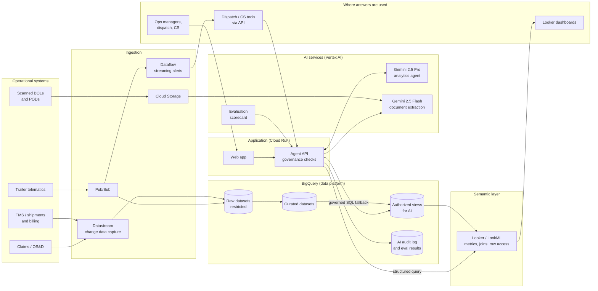

# Target-state architecture on Google Cloud

How the demo would run in production at an LTL carrier: the same design, with managed services in place of local
stand-ins. Decisions and tradeoffs are in [docs/adr](adr/).

## Reference architecture

## Layers

| Layer | Demo today | Production | Why |
|---|---|---|---|
| Ingestion | Synthetic data generators | **Datastream** (CDC from TMS, claims and billing databases), **Pub/Sub** for telematics with a BigQuery subscription, **Dataflow** for real-time alerts | Near-real-time data without custom pipelines; telematics scale is millions of pings a day |
| Data | One dataset with raw tables and `v_` views | Separate **raw**, **curated** and **AI-facing** datasets; AI reads only **authorized views** | The AI's service account can't see raw data even by mistake |
| Semantic layer | `semantic.py` (metric definitions in Python) | **Looker / LookML** | One definition of each metric shared by dashboards and AI; Looker generates the SQL |
| AI | Gemini 2.5 Pro (agent) and Flash (documents) on Vertex AI | Same, in the company's Google Cloud project, with model versions pinned | Data stays in the company's project; Google does not use customer data to train its models |
| Application | Docker Compose on a laptop | **Cloud Run** behind **Identity-Aware Proxy** (staff SSO) and an API for other systems | Scales to zero, no servers to manage, SSO without custom auth code |
| Quality | Scorecard run on demand (`./scripts/dev.sh eval`) | Scorecard in **CI/CD**: blocks a prompt or model change that lowers the score | Treats prompts and models like code |

## Security and governance

Defense in depth: no single control is trusted alone.

| Control | Enforced by |
|---|---|
| Who can use the app | Identity-Aware Proxy, Google groups per role (ops, dispatch, CS, finance) |
| What data the AI can read | Service account with BigQuery Data Viewer on the authorized-views dataset only |
| Sensitive columns | **Policy tags** (column-level security) on contact names, phones, emails; **data masking** for analysts |
| Which rows a user sees | Looker access filters or BigQuery **row-level access policies** (e.g. a terminal manager sees their terminal) |
| What SQL can run | App governance layer: read-only, one SELECT, allowlisted views, dry-run byte cap, row limit |
| Cost | `maximum_bytes_billed` per query, BigQuery reservations or quotas per project, agent step limit |
| Data exfiltration | **VPC Service Controls** perimeter around BigQuery, Vertex AI and Cloud Storage |
| Encryption | Google-managed by default; **CMEK** (Cloud KMS) if required by policy |
| Audit | Every AI query in `ai_audit_log`; Cloud Audit Logs for data access; both exported to Cloud Logging / SIEM |
| AI behavior | Evaluation scorecard (accuracy, metric definitions, safety); safety cases include PII requests, write attempts and prompt injection |

## Integration

- **Into operations tools:** the agent API returns structured answers (text, chart spec, the SQL used), so dispatch,
  customer service or a Teams/Slack bot can call it without the web UI. An MCP server would expose the same tools to
  other AI agents.
- **Alerts:** detention, door-opened-en-route and temperature excursions are computed by Dataflow from the Pub/Sub
  stream and pushed to dispatch, rather than waiting for someone to look at a map.
- **Documents:** BOL extraction writes to BigQuery and can post corrections back to the TMS (billing) after a person
  approves them.

## Operations

| Concern | Approach |
|---|---|
| Availability | Cloud Run (regional, multiple instances); retries with backoff on Gemini 429/503 (already in the agent) |
| Quotas | Vertex AI provisioned throughput for steady load; per-user rate limits in the API |
| Observability | Cloud Logging and Cloud Trace per question: model calls, queries, bytes, latency, tokens, cost |
| Cost | About $0.03 per question (Gemini 2.5 Pro) and under $0.01 per document (Flash); BigQuery scans of a few MB per question |
| Change management | Prompts, semantic definitions and the eval set live in Git; every change runs the scorecard |
